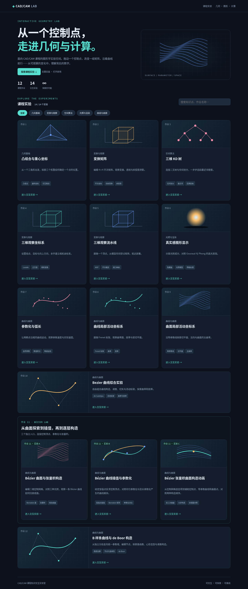
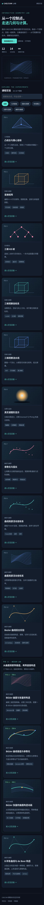
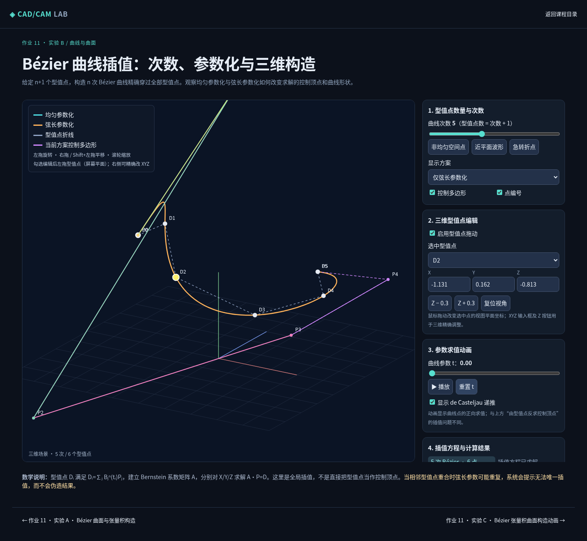
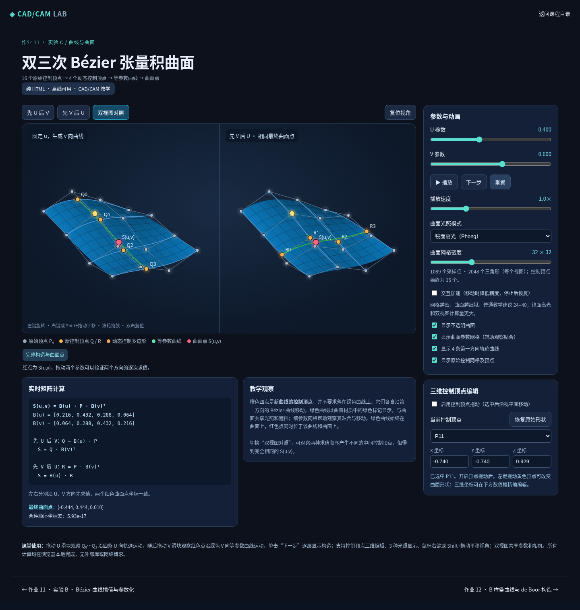

# 作业 11 A/B/C 与首页集成验收

日期：2026-10-28。仓库 `isaacye82/CADCAM2026`。远程 main 为 `82e2369107d4942b2ea012be484f525dcc708ccd`；在包含待审作业12的 `codex/12-bspline` 分支、`dd3c4ae663779c8147c9169fa104ed66b48981ea` 上继续，未合并 main。

## 入口与构建

顺序：作业 10 → 作业 11 · 实验 A（原曲面实验）→ 实验 B（插值）→ 实验 C（张量积动画）→ 作业 12。

- A：`courses/11.bezier-surface.html`，原源码和 URL 保留。
- B：`courses/11.bezier-interpolation.html`。
- C：`courses/11.bezier-tensor-product_surface.html`，保留用户指定下划线。

12 个作业、14 个实验。`lessons` 保留课程数量，`pages` 定义实际页面次序。首页14张入口卡片支持搜索/分类；作业11单独成组，作业10/12以横向卡片衔接。所有原课程入口保留。

上传原始 HTML 保存于 `src/standalone/`。`scripts/standalone.mjs` 在构建时添加同站页头、配色、作业标记、首页与前后导航。原教学脚本原样保留，测试逐段对比源码脚本与生成页面。新增页面使用本地 Canvas 2D 软件投影/光栅化，没有引入 Three.js 或外部依赖；其他原页面继续使用项目现有技术。

C 的三种光照已核查源码：Flat 使用三角形法线计算颜色；Gouraud 在顶点求颜色后按重心插值；Phong 插值法线后逐像素计算光照，三者共用 shade 反射函数。其可选交互加速在运动时可降低精度或临时使用平滑光照；公平比较时保持该选项关闭。

## 实际截图

## 验证

- 构建成功；静态目录17个文件、14个课程 HTML，资源、锚点和相对路径校验通过。
- 54 项自动化测试通过，包括14入口唯一性、10/A/B/C/12顺序、原教学脚本完整性与前后导航。
- 作业12的111项浏览器回归通过；并发负载下动画截图曾错过采样时间窗口，验收脚本将该项速度设为0.25后采样，随后恢复1；生产动画逻辑未改动。
- 新集成浏览器验收34项通过：14卡片、12/14统计、ABC排序、搜索/分类、首页进入三页、3/5/8次两种插值残差均低于1e-7、点编辑、参数化差异、播放/重置、张量积两种求值顺序同点、双视图、三种光照不同画面、参数/顶点编辑、恢复形状、构造单步、导航、加载后断网编辑和390px手机无横向溢出。无页面脚本错误。
- 验收在 `/CADCAM2026/` 子路径的本地 HTTP 服务中执行。脚本为 `tests/browser/bezier-integration.py`，结果为 [acceptance.json](bezier-integration/acceptance.json)。
- 两个新增 HTML 的 file:// 已实际尝试，均被 Chromium 管理策略以 ERR_BLOCKED_BY_ADMINISTRATOR 阻止，不能认定直开通过。无外部依赖与加载后断网操作已通过；普通浏览器直接离线打开需人工确认。
- 浏览器使用 Chromium/SwiftShader；真实 GPU 性能、实体手机触控与其他浏览器仍需人工验收。

## 发布边界

未执行 release、未更新 ZIP、未改 Pages 工作流/Netlify 流程、未部署或合并。原提示词整理文件 `docs/prompts/12-bspline.md` 保持未跟踪，不提交 GitHub。
