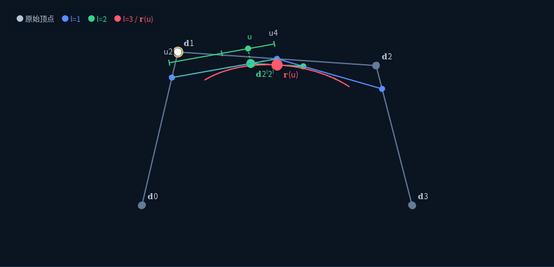
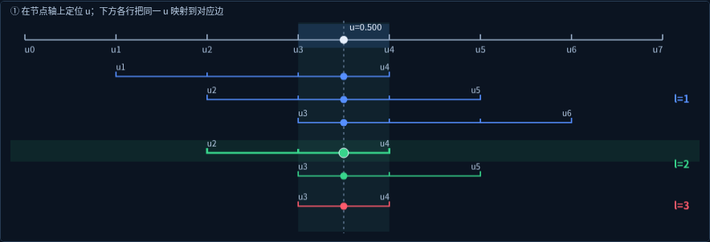

# 作业 12 验收记录：课件式 de Boor 构造与页面精简

日期：2026-10-28。仓库：`isaacye82/CADCAM2026`，草稿 PR #3。

## 展示 5 预览

上方为实际控制多边形及递推点。蓝色是第一层、绿色是第二层、红色是最终曲线点。当前选中第二层的第一条区间，其端点 u₂、u₄ 与对应控制边上的刻度一致。

下方所有区间使用同一节点尺度；竖向虚线是固定参数 u。同色点及 l=1/2/3 对应上方同层的新控制点，点击某一行即可观察对应控制边。

以上为最终 HTML 在本机 Chromium 的实际截图，仅用于审查，不属于运行时资源。动画请直接打开 HTML 查看。

## 本轮要求与实现

- 从所有演示画面删除“u₀ … uₙ₊ₖ₊₁（n=…，k=…）”说明行。节点下标范围及 n=6、k=3 的例子归入“理解背后的数学”。
- 保留节点轴上的下标与一份完整 U。删除轴下逐项节点值和 U 的重复列举；节点编辑框仍可展开逐项输入。
- Nᵢ,ₖ 按钮移到基函数图下方。取消“显示 3 次：N0,3=…；N1,3=…”的重复数值串，仅保留权重和、非零项数量。选中基函数的重复下拉选择器隐藏，直接用按钮选择。
- 删除原抽象割比三角图、两条独立割比分段条和默认展开的权重条。展示 5 改成“定位 u → 映射到控制边 → 连接新点”的课件式过程。
- 保留并统一主画面各层颜色：原始顶点灰白、三次的 l=1 蓝色、l=2 绿色、l=3 与曲线点红色。活动边上画出节点区间刻度和 u 的位置，下方同色区间使用同一 u。
- 固定参数动画先在节点区间定位 u，再沿控制边移动生成新点，随后连接该层的新点。支持逐点播放、暂停、单步、重置和选择任意区间行；重置保持固定 u。
- 新增“课件三次示例”：四个控制顶点、均匀节点 [-3,-2,-1,0,1,2,3,4]、u=0.5，专门对应用户给出的图示。该预设明确载入，不静默覆盖用户数据。
- de Casteljau 对照改为可选开关，数值误差和权重传播放在默认收起的“查看权重对应与数值验证”中。主画面不再重复公式、控制点数、全部权重和误差。
- 五项展示共同精简：心形仅保留必要段数与曲线点读数，当前节点值不在节点编号下拉中重复，探索说明缩短。默认关闭坐标轴，仍可在图层中打开。去除同位置重复绘制的原始顶点和控制多边形。

## 五项展示仍保留的功能

1. 1–5 次均匀曲线、独立局部参数、统一参数域、解析左右导数、增删控制顶点。
2. 0–k 次均匀基函数、非负性、权重和与支撑区间。
3. 独立非均匀曲线和基函数，节点间距滑块、节点轴拖动、逐项数值输入及有效域高亮。
4. 三组指定心形节点，共享 7 个顶点，初始 4/4/2 段，可分别载入展示 3。
5. 上述课件式 de Boor 构造、固定参数或扫描动画，以及 Bézier 特例对照。

控制点支持平面拖动、空间三轴及 XYZ 数值输入，最多 24 个。曲线默认 2px，可调；使用现有 Three.js 本地 Line2，实际宽线生效。手机保留不遮挡主要曲线窗口的非模态底部参数面板。展示 1/2 使用均匀节点，展示 3/5 的可编辑节点保留。

## 数学与区间映射

统一使用 **r**(u)、**d**ᵢ、次数 k、节点 uᵢ。数学算法独立于 DOM/Three.js。

每个新点对应一个节点区间和一条父控制边：

- α=(u−uᵢ)/(uᵢ₊ₖ₋ₗ₊₁−uᵢ)。
- 新点为 (1−α)A+αB；在实际控制边上按同一 α 取点。
- 连接该层的新点后，以新的控制多边形继续，直到得到 **r**(u)。

课件三次示例的三层区间依次为：

| 递推层 | 区间 | u=0.5 时的比例 α |
|---|---|---|
| l=1 | [u₁,u₄]、[u₂,u₅]、[u₃,u₆] | 5/6、1/2、1/6 |
| l=2 | [u₂,u₄]、[u₃,u₅] | 3/4、1/4 |
| l=3 | [u₃,u₄] | 1/2 |

`deBoorTeachingExample` 定义这个可复现预设；`deBoorStep` 给出每一步对应的节点端点、父点、新点及比例。参数区间图与实际控制边共用这份数据，不另造近似比例。刻度映射到真实三维父边后再投影，旋转视角时仍贴合控制边。

继续保留 Cox–de Boor 与 de Boor 的独立求值、解析左右导数、重复节点零分母约定、内部节点取右区间、有效域右端取精确左极限、非零区间逐段采样及局部支撑。权重沿相同递推传播，最终与独立基函数值一致，可在折叠区域核验。

## 最终验收

| 检查 | 结果 |
|---|---|
| `pnpm run build` | 成功，12 个独立课程 HTML |
| `pnpm test` | 52/52 通过（原有 34 项、18 项 B 样条测试） |
| `pnpm run check:site` | 15 个发布文件通过 |
| 完整差异及 staged `git diff --check` | 通过 |
| Chromium WebGL2 浏览器检查 | 77 项通过，无 JS/WebGL 错误 |

新增数学测试逐项验证课件示例的 3/2/1 个区间、六个比例与控制边插值，最终点与独立基函数求值一致。其他数学测试覆盖 0–5 次、分段、局部影响、显式三次公式、解析连续性、重复与非均匀节点、端点、两种求值算法、Bézier/de Casteljau 各层、权重传播及不连续分段等。

浏览器检查覆盖：五项展示去重、按钮位于图下、课件预设、六行区间、点击行选择对应控制边、空间蓝绿红像素、折叠验证，以及原有次数/分段/节点/心形/算法对照/动画/宽线/三轴/资源复用/离线断网/手机布局功能。

原始结果为 `BSPLINE_BROWSER.json`。可复现脚本 `tests/browser/bspline.py` 需要 Python Playwright、Pillow、`/usr/bin/chromium` 和本机 socket 权限，不增加生产依赖。截图和中间数据在 `work/12-bspline/`。

## 基线与发布限制

初版基于 `origin/main` 的 `82e2369107d4942b2ea012be484f525dcc708ccd`；本轮从同一 PR 分支的 `e6ef3fc67cceaac29fa686dcfb3f493a5f658218` 继续，fetch 确认远端一致，工作区无已跟踪修改。原有 work/ 临时文件保留。

本轮改动数学预设、界面、绘图、样式、测试、README、验收记录、两张审查截图及构建生成的 HTML。原 11 课源码和 URL、生产依赖与锁文件、构建/打包脚本、Pages 工作流、Netlify 配置保持不变。

file:// 直开已实际尝试，仍被 Chromium 管理策略以 `ERR_BLOCKED_BY_ADMINISTRATOR` 阻止，未记为通过。全部资源内联、无外部资源引用及加载后断网交互已通过。普通浏览器断网直开、真实 GPU 性能、实体手机触控和其他浏览器需人工确认。

未执行 release、未更新 ZIP、未部署、未合并；继续通过原草稿 PR #3 等待审核。
